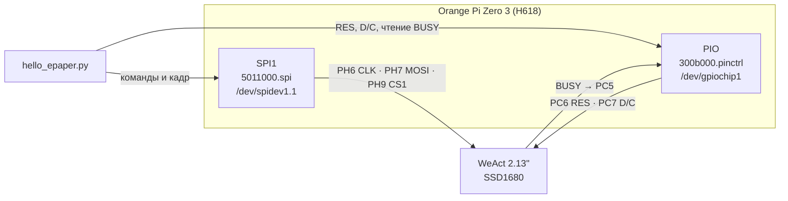

# Как это работает

## Путь сигнала

Дисплей только принимает данные: MISO (PH8, пин 21) не подключён и не нужен.

## Программный стек

| Что | Пакет | Для чего |
|---|---|---|
| `spidev` | `python3-spidev` | Запись в `/dev/spidev1.1`, SPI mode 0, 4 МГц |
| `gpiod` | `python3-libgpiod` 2.x | Линии RES и D/C (выходы), BUSY (вход). API v2: `gpiod.request_lines`, `gpiod.line.Value` |
| `PIL` | `python3-pil` | Отрисовка текста в однобитные изображения |
| DejaVu Sans Bold | `fonts-dejavu-core` | Шрифт |

## Как Linux видит пины

### GPIO

У H618 два контроллера выводов, и у каждого свой `gpiochip`:

| Контроллер | Банки | `gpiochip` на этой плате |
|---|---|---|
| `7022000.pinctrl` (R_PIO) | PL | `gpiochip0` |
| `300b000.pinctrl` (PIO) | PA…PI — всё, что на разъёме | `gpiochip1` |

Номера `gpiochip` не гарантированы, поэтому скрипт ищет контроллер по метке `300b000.pinctrl`.

Номер линии внутри контроллера = номер банка × 32 + номер вывода в банке (A = 0, B = 1, C = 2, …, H = 7):

| Вывод | Расчёт | Линия |
|---|---|---|
| PC5 (BUSY) | 2 × 32 + 5 | 69 |
| PC6 (RES) | 2 × 32 + 6 | 70 |
| PC7 (D/C) | 2 × 32 + 7 | 71 |

### SPI

SPI1 включается через device tree. Нужны два overlay:

- **`spidev1_1`** (идёт с Armbian) — включает контроллер SPI1 и создаёт на нём устройство
  `spidev@1`, то есть `/dev/spidev1.1` с аппаратным chip select CS1;
- **`spi1-pins`** (наш, [`spi1-pins.dts`](../spi1-pins.dts)) — переводит пины PH6, PH7, PH8 в режим SPI1,
  а PH9 — в режим CS1 (`pinctrl-0 = <&spi1_pins>, <&spi1_cs1_pin>`).

Без второго overlay контроллер работает, `/dev/spidev1.1` существует, запись проходит без ошибок, —
но на разъём ничего не выходит. См. [грабли 6 и 7](pitfalls.md#6-overlay-spidev1_x-не-назначает-пины).

## Протокол SSD1680

Четырёхпроводный SPI: линия D/C отличает команды от данных.

- **команда** — D/C = 0, один байт;
- **параметры / данные** — D/C = 1, сколько угодно байт.

CS опускает сам контроллер SPI на время каждой передачи (`writebytes2`), биты идут старшим вперёд.

### Инициализация

| Шаг | Команда | Данные | Смысл |
|---|---|---|---|
| Аппаратный сброс | — | — | RES: 1 → 0 на 2 мс → 1 |
| SW reset | `0x12` | — | Программный сброс, регистры по умолчанию |
| Driver output | `0x01` | `F9 00 00` | 250 строк (gate) |
| Data entry | `0x11` | `03` | Автоинкремент: сначала X, потом Y |
| RAM X | `0x44` | `00 0F` | Окно по X: байты 0–15 (128 пикселей, используются 122) |
| RAM Y | `0x45` | `00 00 F9 00` | Окно по Y: строки 0–249 |
| Border | `0x3C` | `05` | Форма волны для рамки панели |
| Update control | `0x21` | `00 80` | Обе RAM без инверсии; выходы источника S8–S167 |
| Температура | `0x18` | `80` | Встроенный датчик температуры (от неё зависит LUT) |

После каждой операции, которая выставляет BUSY, скрипт ждёт, пока BUSY опустится
(после SW reset — минимум 10 мс, так как BUSY на нашем модуле не работает).

### Память кадра

Родная ориентация панели — портретная: 122 пикселя по X (выходы источника) × 250 строк по Y (gate).

- Строка — 16 байт: 122 бита изображения + 6 бит выравнивания.
- Слой — 16 × 250 = **4000 байт**. Это меньше буфера spidev по умолчанию (4096 байт).
- У трёхцветной панели два слоя:

| RAM | Команда записи | Бит = 1 | Бит = 0 |
|---|---|---|---|
| Ч/б | `0x24` | белый | чёрный |
| Красный | `0x26` | красный | нет красного |

Полярность красного слоя задаёт первый байт `0x21`: при `0x00` единица означает красный.

Перед записью каждого слоя курсор RAM возвращается в начало (`0x4E 00`, `0x4F 00 00`):
иначе второй слой продолжится с того адреса, где закончился первый.

### Отрисовка

1. Текст рисуется в альбомной ориентации 250×122 в режиме Pillow `"1"` (1 бит на пиксель, 1 = белый).
   Размер шрифта уменьшается с 48 с шагом 2, пока строка не влезет в ширину минус 16 пикселей.
2. Красный слой — отдельное изображение 250×122, где единицами нарисована рамка толщиной 3 пикселя.
3. Оба изображения поворачиваются на 90° в родную ориентацию 122×250.
4. `Image.tobytes()` в режиме `"1"` упаковывает строки старшим битом вперёд с выравниванием до байта —
   это ровно формат RAM SSD1680, никаких преобразований не нужно.

Если текст окажется вверх ногами (зависит от того, как закреплён модуль), замените `rotate(90` на `rotate(-90`.

### Обновление и сон

| Команда | Данные | Смысл |
|---|---|---|
| `0x22` | `F7` | Полное обновление: включить генератор и аналоговую часть, загрузить температуру и LUT из OTP, вывести, выключить |
| `0x20` | — | Запустить обновление |
| `0x10` | `01` | Глубокий сон |

Полное обновление трёхцветной панели идёт 20–30 секунд (по замеру BUSY мультиметром).
Через 0.1 с после `0x20` скрипт проверяет BUSY:

- BUSY = 1 — ждёт, пока он опустится (таймаут `REFRESH_TIME` + 10 с);
- BUSY = 0 — значит, линия не работает: скрипт пишет предупреждение и ждёт фиксированные `REFRESH_TIME` = 30 с.

В глубоком сне e-paper держит картинку без питания. Следующий запуск будит контроллер аппаратным сбросом.

## Статус-страница Uptime Kuma

[`status_epaper.py`](../status_epaper.py) импортирует из `hello_epaper.py` класс `EPD` и размеры панели,
а сам только забирает данные и рисует оба слоя.

### Данные

Публичная статус-страница Kuma (`/status/<slug>`) отдаёт данные без авторизации двумя запросами:

| Запрос | Что берём |
|---|---|
| `GET /api/status-page/<slug>` | `config.title` — название; `publicGroupList[].monitorList[]` — `id` и `name` сервисов по порядку |
| `GET /api/status-page/heartbeat/<slug>` | `heartbeatList["<id>"]` — последние проверки `{status, time}` |

- Проверок на каждый сервис — **не больше 100 последних**. При интервале 60 с это ~100 минут,
  на час хватает. Если интервал у сервиса меньше 36 с, 100 проверок покроют меньше часа,
  и столбики просто начнутся не с левого края.
- `time` — **UTC без указания зоны** (`"2026-10-26 23:33:58.290"`), скрипт так его и читает.
  Местное время нужно только для заголовка.
- Ответ — **снимок, который обновляется раз в минуту**, поэтому час отсчитывается от самой свежей
  проверки в снимке, а не от часов платы ([грабли 11](pitfalls.md#11-у-одного-сервиса-на-столбик-больше)).
- Коды `status`:

| Код | В Kuma | На экране |
|---|---|---|
| 1 | UP | Чёрный столбик |
| 0 | DOWN | Красный столбик |
| 2 | PENDING — проверка не прошла, Kuma перепроверяет | Красный столбик |
| 3 | MAINTENANCE | Чёрный столбик в половину высоты |

Если последняя проверка — DOWN или PENDING, имя сервиса тоже красное.

### Разметка

Альбомная ориентация 250×122, как и у текста, потом поворот в родную 122×250.

- Заголовок (`SHOW_HEADER`) — 14 px, остальная высота делится между сервисами поровну:
  при 6 сервисах по 18 px на строку.
- Справа всегда `BARS` = 60 столбиков с шагом 3 px (`BAR_W` + `BAR_GAP`) — 180 px, по столбику
  на минуту при проверке раз в минуту. Имени остаётся ~60 px, длинное обрезается с «…».
- Если проверок за час больше, чем столбиков (интервал меньше минуты), соседние склеиваются,
  и группа получает худший статус: DOWN > PENDING > MAINTENANCE > UP. Короткий сбой при склейке не теряется.
- Красное рисуется только в красном слое, а в ч/б слое эти пиксели остаются белыми.

Ошибки сети, HTTP и разбора JSON не роняют скрипт: вместо столбиков рисуется экран
«Мониторинг недоступен» с причиной и временем. Ошибки самого дисплея по-прежнему падают с трассировкой.

## Настройка системы

[`setup.sh`](../setup.sh) делает всё, что требует root, один раз:

| Что | Где | Зачем |
|---|---|---|
| Пакеты | apt | Python-модули, шрифт, `dtc` |
| Группы `gpio`, `spi` | `/etc/group` | Доступ без `sudo` |
| udev-правило | `/etc/udev/rules.d/99-gpio-spi.rules` | `/dev/gpiochip*` → группа `gpio`, `/dev/spidev*` → группа `spi`, режим 0660 |
| Overlay | `/boot/overlay-user/spi1-pins.dtbo` | Назначить пины SPI1 |
| Загрузчик | `/boot/armbianEnv.txt` | `overlays=… spidev1_1`, `user_overlays=spi1-pins` |

Загрузочный скрипт Armbian (`/boot/boot.cmd`) сначала применяет overlay из `overlays=`
(`/boot/dtb/allwinner/overlay/sun50i-h616-<имя>.dtbo`), потом пользовательские из `user_overlays=`
(`/boot/overlay-user/<имя>.dtbo`).
